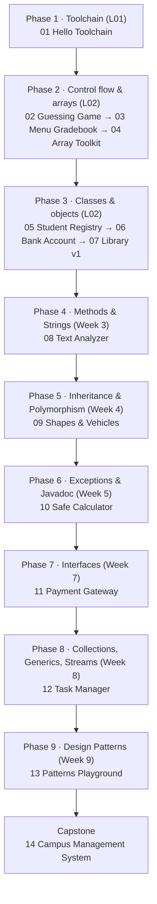

# Java Project Roadmap

A learn-by-building path for Java and OOP. Each project is a spec: a goal, requirements, milestones and a "done when" checklist. You write the code, so there are no solutions here.

The order follows my CIS 201 (Object Oriented Programming) course, Ain Shams FCAI, Fall 26-27. Projects 01-07 are unlocked by lectures L01 and L02. Projects 08-14 follow the syllabus weeks that come next, so I'll build them as the course reaches those topics.

---

## The map



## Projects

| # | Project | Unlocked by | Core concepts | Difficulty |
|---|---------|-------------|---------------|-----------|
| 01 | [Hello Toolchain](projects/01-hello-toolchain) | L01 | `javac`/`java`, `main`, `Scanner`, int division | ★☆☆☆☆ |
| 02 | [Number Guessing Game](projects/02-number-guessing-game) | L02 | `if-else`, `while`/`do-while`, `break`/`continue` | ★☆☆☆☆ |
| 03 | [Menu-Driven Gradebook](projects/03-menu-gradebook) | L02 | `switch`, `for`, foreach, arrays | ★★☆☆☆ |
| 04 | [Array Toolkit](projects/04-array-toolkit) | L02 | arrays, reference semantics, `null` defaults | ★★☆☆☆ |
| 05 | [Student Registry](projects/05-student-registry) | L02 | classes, objects, constructors, `new`, dot operator | ★★☆☆☆ |
| 06 | [Bank Account](projects/06-bank-account) | L01 + L02 | encapsulation, access modifiers, `static`, `final` | ★★★☆☆ |
| 07 | [Library System v1](projects/07-library-system-v1) | L02 | UML, packages, access matrix, `static` ID generator | ★★★☆☆ |
| 08 | [Text Analyzer](projects/08-text-analyzer) | Week 3 | methods, `String` API | ★★★☆☆ |
| 09 | [Shapes & Vehicles](projects/09-shapes-and-vehicles) | Week 4 | inheritance, overriding, overloading, `super` | ★★★☆☆ |
| 10 | [Safe Calculator](projects/10-safe-calculator) | Week 5 | exceptions, custom exceptions, Javadoc | ★★★☆☆ |
| 11 | [Payment Gateway](projects/11-payment-gateway) | Week 7 | interfaces, polymorphism via interfaces | ★★★★☆ |
| 12 | [Task Manager](projects/12-task-manager) | Week 8 | `List`, generics, streams | ★★★★☆ |
| 13 | [Patterns Playground](projects/13-patterns-playground) | Week 9 | Singleton, Factory, Observer, Strategy | ★★★★☆ |
| 14 | [Campus Management System](projects/14-campus-management-capstone) | All | everything above, plus file persistence | ★★★★★ |

## Progress tracker

- [ ] 01 Hello Toolchain
- [ ] 02 Number Guessing Game
- [ ] 03 Menu-Driven Gradebook
- [ ] 04 Array Toolkit
- [ ] 05 Student Registry
- [ ] 06 Bank Account
- [ ] 07 Library System v1
- [ ] 08 Text Analyzer
- [ ] 09 Shapes & Vehicles
- [ ] 10 Safe Calculator
- [ ] 11 Payment Gateway
- [ ] 12 Task Manager
- [ ] 13 Patterns Playground
- [ ] 14 Campus Management Capstone

## How to work through a project

1. Read the project's `README.md` and don't look at hints yet.
2. Draw the UML class diagram on paper first (for 05 and later). L02 covers the 3-compartment box and `+ # -` visibility.
3. Build milestone by milestone. Compile and run after every milestone, not at the end.
4. Tick every box under **Done when**.
5. Commit with a message that names the milestone, e.g. `05: add Student constructors`.
6. Write 3-5 lines in the project's `NOTES.md` about what broke and what you learned.

## Running Java from the terminal

```bash
# single file
javac MyClass.java
java MyClass

# a project with packages (run from the project folder)
mkdir -p out
javac -d out $(find src -name "*.java")
java -cp out com.example.Main
```

Rules to remember: the file name must match the `public` class name exactly, and `main` must be `public static void main(String[] args)`.

## Repo layout

```
java-project-roadmap/
├── README.md              ← this map
├── docs/
│   └── PROJECT_TEMPLATE.md
└── projects/
    ├── 01-hello-toolchain/
    │   ├── README.md      ← the spec
    │   ├── NOTES.md       ← your reflections (create it as you go)
    │   └── src/           ← your code goes here
    └── ...
```

## Resources

- *Java How to Program, Early Objects*, 11th ed. (Deitel & Deitel), the course textbook
- Oracle JDK 17 documentation
- TutorialsPoint Java and BeginnersBook Java
