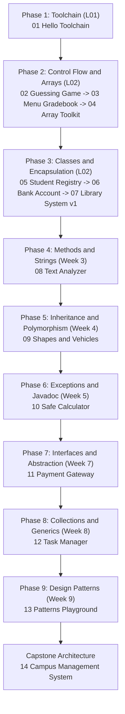

# Java Project Roadmap (Curriculum Learning Path)

**Live Demo:** Not deployed (local execution only)

A structured, curriculum-aligned project progression for mastering Java and Object-Oriented Programming from command-line fundamentals to architectural design patterns.


## Table of Contents
- [About](#about)
- [Architecture](#architecture)
- [Features](#features)
- [Tech Stack](#tech-stack)
- [Run Locally](#run-locally)
- [Project Structure](#project-structure)

## About
This repository delivers an engaging, milestone-driven learning roadmap tailored for second-year computer science students acquiring Java and object-oriented software engineering skills. The track strictly aligns with the CIS 201 curriculum at Ain Shams University Faculty of Computer and Artificial Intelligence (Fall 2026/2027). Each module provides production-grade reference implementations alongside structured hands-on practice challenges and pedagogical hints.

## Architecture
The curriculum is organized into sequential phases where each milestone unlocks advanced language mechanics and design patterns:



Projects 01 through 07 are unlocked and fully implemented based on lectures L01 and L02. Projects 08 through 14 represent planned milestones aligned with subsequent syllabus topics.

## Features
- **Curriculum-Gated Progression**: Unlocks concepts systematically to eliminate cognitive overload and build solid foundations.
- **Relatable Real-World Domains**: Grounds theoretical syntax in practical systems such as currency converters, vault crackers, and digital wallets.
- **Dual Learning Model**: Supplies complete working reference code alongside structured TODO practice challenges for hands-on building.
- **Terminal-First Workflow**: Emphasizes direct command-line `javac` compilation and `java` launcher execution without IDE reliance.
- **Modular Package Encapsulation**: Enforces separation of concerns across domain models, service coordinates, and CLI drivers.

### Project Directory and Curriculum Status

| Project ID | Project Title | Course Prerequisite | Real-World Concept | Difficulty | Status |
| :--- | :--- | :--- | :--- | :--- | :--- |
| 01 | [Hello Toolchain](projects/01-hello-toolchain) | L01 | Student Expense & Currency Suite | 1/5 | Implemented |
| 02 | [Number Guessing Game](projects/02-number-guessing-game) | L02 | Security Vault Cracker & Sonar | 1/5 | Implemented |
| 03 | [Menu Gradebook](projects/03-menu-gradebook) | L02 | Academic Transcript & Honors Portal | 2/5 | Implemented |
| 04 | [Array Toolkit](projects/04-array-toolkit) | L02 | Digital Audio & Waveform Analyzer | 2/5 | Implemented |
| 05 | [Student Registry](projects/05-student-registry) | L02 | Collegiate Advising & Standing System | 2/5 | Implemented |
| 06 | [Bank Account](projects/06-bank-account) | L01, L02 | NeoBank Wallet with PIN Authentication | 3/5 | Implemented |
| 07 | [Library System v1](projects/07-library-system-v1) | L02 | Campus Media Hub & Multi-Package UML | 3/5 | Implemented |
| 08 | [Text Analyzer](projects/08-text-analyzer) | Week 3 | String API immutability, static helpers | 3/5 | Upcoming |
| 09 | [Shapes and Vehicles](projects/09-shapes-and-vehicles) | Week 4 | Inheritance, method overriding, super | 3/5 | Upcoming |
| 10 | [Safe Calculator](projects/10-safe-calculator) | Week 5 | Exception hierarchy, custom errors | 3/5 | Upcoming |
| 11 | [Payment Gateway](projects/11-payment-gateway) | Week 7 | Interface contracts, polymorphism | 4/5 | Upcoming |
| 12 | [Task Manager](projects/12-task-manager) | Week 8 | Collections framework, Generics, Streams | 4/5 | Upcoming |
| 13 | [Patterns Playground](projects/13-patterns-playground) | Week 9 | Singleton, Factory, Observer, Strategy | 4/5 | Upcoming |
| 14 | [Campus Management Capstone](projects/14-campus-management-capstone) | Capstone | Enterprise architecture, file persistence | 5/5 | Upcoming |

## Tech Stack
- **Language**: Java 21 (LTS)
- **Runtime**: OpenJDK 64-Bit Server VM
- **Build System**: Terminal `javac` CLI and Bash automation
- **Modeling**: Unified Modeling Language (UML) via Mermaid
- **Documentation**: Diátaxis Technical Documentation Standard

## Run Locally

### Prerequisites
- OpenJDK 17 or OpenJDK 21 installed and verified:
  ```bash
  javac -version
  java -version
  ```

### Installation
Clone the repository and inspect the directory structure:
```bash
git clone https://github.com/Omar-Ayman-Ali/java-project-roadmap.git
cd java-project-roadmap
```

### Execution
Compile and run any unlocked project module. For example, to build and run the Campus Media Lending Hub:

```bash
cd projects/07-library-system-v1
mkdir -p bin
javac -d bin $(find src -name "*.java")
java -cp bin library.app.Main
```

Alternatively, to compile and run the NeoBank Digital Wallet management console:

```bash
cd projects/06-bank-account
mkdir -p bin
javac -d bin src/*.java
java -cp bin BankApp
```

## Project Structure
```
java-project-roadmap/
├── README.md
├── docs/
│   └── PROJECT_TEMPLATE.md
└── projects/
    ├── 01-hello-toolchain/
    │   ├── README.md
    │   └── src/
    ├── 02-number-guessing-game/
    │   ├── README.md
    │   └── src/
    ├── 03-menu-gradebook/
    │   ├── README.md
    │   └── src/
    ├── 04-array-toolkit/
    │   ├── README.md
    │   └── src/
    ├── 05-student-registry/
    │   ├── README.md
    │   └── src/
    ├── 06-bank-account/
    │   ├── README.md
    │   └── src/
    ├── 07-library-system-v1/
    │   ├── README.md
    │   ├── uml.md
    │   └── src/
    └── 08-text-analyzer/ ... 14-campus-management-capstone/
```
