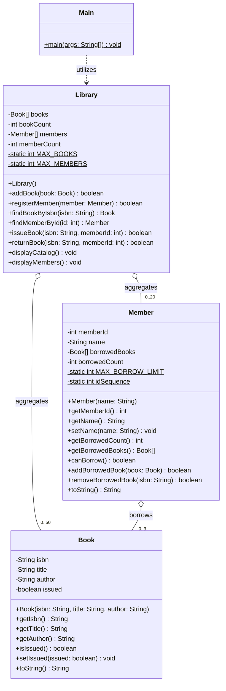

# UML Class Diagram (Library System v1)

## Notation Legend
- `+` Public member
- `-` Private member
- `#` Protected member
- `$` Static member
- `o--` Aggregation relationship
- `..>` Dependency relationship
